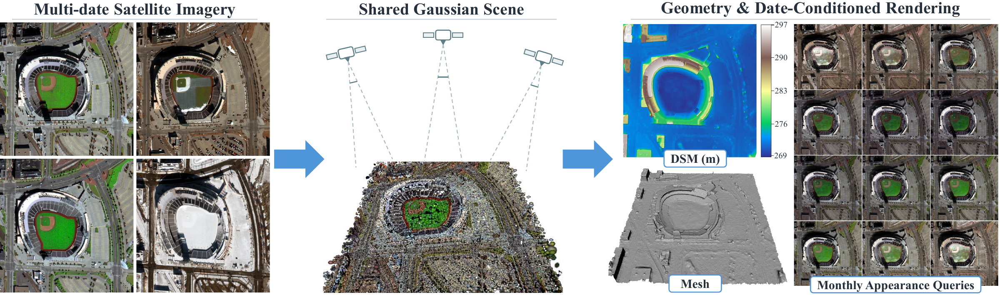

<h1 align="center">Multi-SatGS</h1>

<strong>Surface Reconstruction and Date-Conditioned Rendering from Multi-Date Satellite Images</strong>

  

This repository accompanies **Multi-SatGS**, a Gaussian splatting framework for
reconstructing shared surface geometry and continuous seasonal appearance from
multi-date satellite imagery. It supports DSM and mesh reconstruction, novel-view
rendering, and date-conditioned appearance queries without target-image fitting.

*One shared scene representation for surface reconstruction and continuous seasonal appearance queries.*

## News

- **2026-10-16:** Our Multi-SatGS study and manuscript are complete.

## Code availability

The source code is not publicly available yet. **We will release the code in this
repository after the paper is accepted for publication.**

